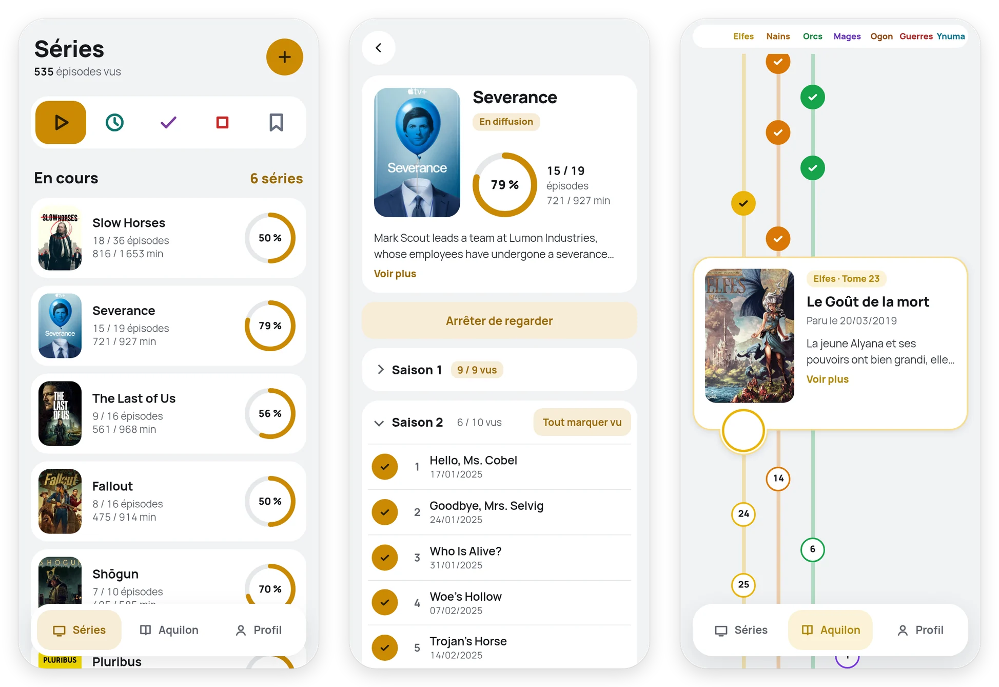
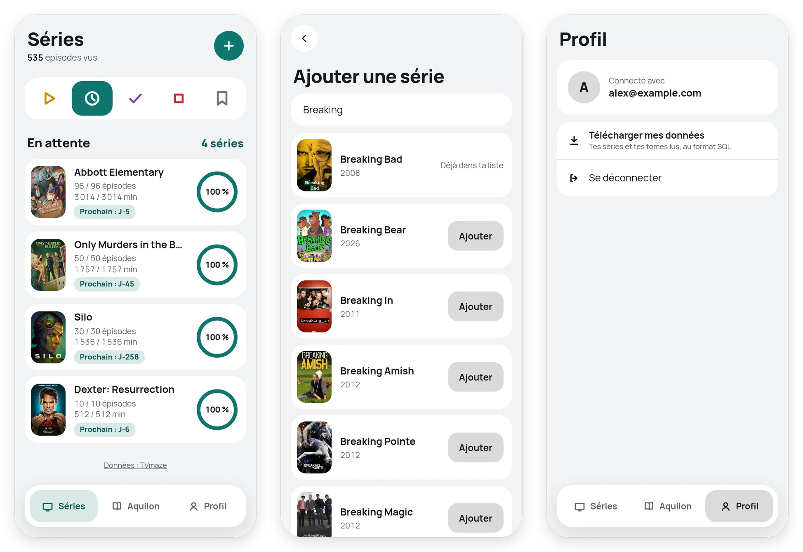

# Maxdom

A small web app for keeping track of the TV shows you watch and the *Chroniques d'Aquilon* comics you read. You tick episodes as you go, and Maxdom sorts your shows, counts what's left and tells you when the next episode airs. Each friend you let in gets their own list. The interface is in French.

<picture>
  <source media="(prefers-color-scheme: dark)" srcset="docs/screenshots/overview-dark.webp">
  
</picture>

It runs on Cloudflare Workers and D1, on the free plans.

## What it does

### Series

Search for a show (the data comes from [TVmaze](https://www.tvmaze.com)) and add it. Your list is split into five tabs, and shows move between them on their own as you watch:

- En cours: aired episodes you haven't seen yet.
- En attente: you're caught up and the show is still airing. A badge counts the days to the next episode.
- Terminées: the show has ended and you saw all of it.
- Arrêtées: shows you dropped. Their ticks stay, and you can pick them up again at any time.
- À voir: added, not started.

Each show has its own page with your progress in episodes and in minutes, the show's summary and its seasons. Tick episodes one at a time or a whole season at once. Tap an episode to see its picture, runtime, TVmaze rating and summary. A daily job picks up new episodes and changed air dates from TVmaze.

### Aquilon

*Les Chroniques d'Aquilon* is a French fantasy comics universe published by Soleil, split into seven series: Elfes, Nains, Orcs & Gobelins, Mages, Terres d'Ogon, Guerres d'Arran and Terres d'Ynuma. The Aquilon tab draws every volume on a single tree in publication order, one column per series, so you always know what to read next across all of them. Tap a circle to open the volume's card with its cover and summary, and tick it once you've read it. The catalogue updates itself every Monday from [monde-aquilon.com](https://www.monde-aquilon.com).

### Accounts

Anyone you let through Cloudflare Access gets their own list on their first visit, with no sign-up form. Shows and volumes are stored once for everybody, while the ticks belong to each account and nobody sees anyone else's list. The Profil tab downloads your own data as a SQL file that restores into any Maxdom database.

<picture>
  <source media="(prefers-color-scheme: dark)" srcset="docs/screenshots/more-dark.webp">
  
</picture>

The app follows your system's light or dark theme. It's made for phones first but works just as well in a desktop browser.

## How it's built

One Cloudflare Worker serves the front end from `public/` (plain JavaScript modules, no framework, no build step) and a small JSON API from `src/`, on top of a D1 database, which is SQLite. Two cron triggers keep the shows and the Aquilon catalogue up to date. Cloudflare Access handles logins: the Worker checks the token Access signs on each request (`Cf-Access-Jwt-Assertion`) rather than using `ctx.access`, because Cloudflare doesn't pass `ctx.access` to a Worker that serves static assets. The tests run with Vitest.

## Deploying from scratch

It takes Node 22 or later and a Cloudflare account.

```sh
npm install
npx wrangler login
npx wrangler d1 create maxdom        # put the printed database_id in wrangler.jsonc
npx wrangler d1 migrations apply maxdom --remote
npx wrangler deploy
```

Then put the Worker behind Cloudflare Access, from the Worker's Access tab in the Cloudflare dashboard (the first time, it asks you to set up a Zero Trust organization, which is free). The rest happens in the Zero Trust dashboard (one.dash.cloudflare.com):

1. Under Integrations > Identity providers, add One-time PIN, so people log in with a code sent to their email.
2. Under Access > Applications, give the Worker's application a policy that says who may log in.
3. Copy the team domain (`https://<team>.cloudflareaccess.com`) and the application's audience (AUD) tag into `ACCESS_TEAM_DOMAIN` and `ACCESS_AUD` in `wrangler.jsonc`, then run `npx wrangler deploy` again.

On a new Cloudflare account, all three values in `wrangler.jsonc` (`database_id`, team domain and AUD tag) change. Until the two Access values match the application, the Worker refuses every API request. Renaming the application keeps its AUD tag; deleting and recreating it doesn't.

About the policy: allowing everyone means anyone who finds the URL can make an account. D1's free plan reads 5 million rows a day, plenty for a group of friends but not for strangers.

The Aquilon tab stays empty until the catalogue job first runs, on the Monday after you deploy.

## Local development

```sh
echo "DEV_EMAIL=you@example.com" > .dev.vars
npm run db:migrate
npm run dev         # http://localhost:8787
npm test
```

There is no Cloudflare Access in local development, so the Worker takes the account from `DEV_EMAIL` in `.dev.vars` (ignored by git). Never set `DEV_EMAIL` in `wrangler.jsonc` or in the Cloudflare dashboard: it turns the login check off.

Wrangler never runs the cron jobs on its own in local development. With `npm run dev` running, trigger the daily TVmaze refresh by hand:

```sh
curl "localhost:8787/cdn-cgi/local/scheduled"
```

Each run only looks at the shows TVmaze changed in the past week, and refreshes at most 10 of them.

The weekly job reads the Aquilon catalogue and adds or updates volumes. It never deletes one. A volume's summary is read from its page on the site the first time someone opens it, then kept in the database (only once the volume is out); the job forgets it when the volume's title or date changes, so it is read again. To run it by hand, pass its schedule:

```sh
curl "localhost:8787/cdn-cgi/local/scheduled?cron=0+6+*+*+1"
```

## Backing up and restoring

Once the app is online, its D1 database is the one that matters. Export it whole, every account included (schema, migration history and data), to a SQL file:

```sh
npm run db:backup                                                          # online database, into data/backup-<date>-<time>.sql
npx wrangler d1 export maxdom --local --output=data/backup-YYYY-MM-DD.sql   # local database
```

To restore one into an empty database, for example on a new machine, run the file as is. Don't run `npm run db:migrate` before: the export already creates the tables.

```sh
npx wrangler d1 execute maxdom --local --file=data/backup-YYYY-MM-DD.sql
```

The "Télécharger mes données" button on the Profil page is different: it only holds the logged-in account, with the shows it follows, their episodes and the Aquilon volumes. It is made of `INSERT OR IGNORE` statements, so it restores the same way into a Maxdom database that already has its tables and other accounts, without touching them.

`data/` is ignored by git because it holds personal data, so keep a copy of the backups somewhere else too.

## Deploying changes

After a code change, `npx wrangler deploy` puts it online. A new migration has to be applied to the online database first, with `npx wrangler d1 migrations apply maxdom --remote`, after a `npm run db:backup`.

On 2026-10-24 the six migrations written while building the app were merged into `0001_init.sql`, which creates the current schema. Nothing ran again on the existing databases: D1 remembers applied migrations by file name, and `0001_init.sql` was already on their list.

## Credits

The code is here to be read. It comes with no license, so all rights are reserved. Show data comes from TVmaze under CC BY-SA, which is why the app credits it at the bottom of the Séries pages. The Aquilon catalogue, summaries and covers belong to their publisher and are read from monde-aquilon.com.
